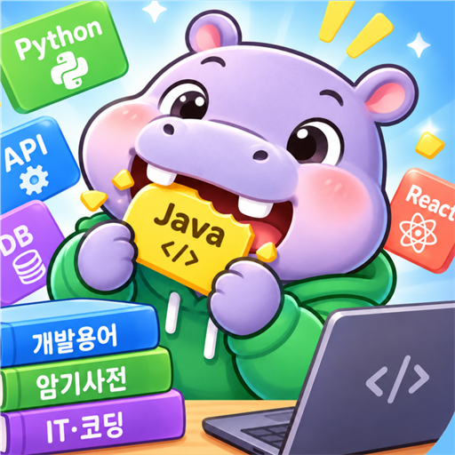

# play-launch — 구글 플레이 출시 문답 스킬

안드로이드 앱을 구글 플레이 콘솔에 처음 등록·출시하거나 새 버전을 올릴 때 쓰는
[Claude Code](https://code.claude.com) 스킬이다.

이 스킬은 **정답집이 아니다.** 다음 두 가지를 담고 있다.

1. **확인하며 한 단계씩 진행하는 절차** — Claude가 메뉴 경로나 요건을 기억으로 추측하지 않고,
   지금 보이는 콘솔 화면·앱 코드·구글 공식 문서로 확인한 뒤에 한 항목씩 안내하게 한다.
2. **함정 목록** — 실제 출시 2회에서 막히거나 틀렸던 것들. 항목마다 근거 수준
   (`[확인]`·`[이 계정]`·`[문서]`·`[가설]`·`[문서 확인 필요]`)이 표시되어 있어
   어디까지 믿어도 되는지 구분된다.

**Claude가 Play 콘솔을 직접 조작하지는 않는다.** 콘솔 입력과 제출은 언제나 사용자가 한다.

> ## ⚠️ 한계 — 비공개 테스트 요건은 검증되지 않았다
>
> Google Play는 **2023년 11월 13일 이후에 만든 개인 개발자 계정**에 프로덕션 출시 전
> 비공개 테스트를 요구한다. **테스터 12명 이상이 14일 이상 연속으로 참여**해야
> 프로덕션 액세스를 신청할 수 있다.
> (근거: Play Console 고객센터 「[새로운 개인 개발자 계정의 앱 테스트 요구사항](https://support.google.com/googleplay/android-developer/answer/14151465?hl=ko)」)
>
> 이 스킬의 바탕이 된 출시 2회는 **이 요건이 적용되지 않는 계정**(기준일 이전에 만든 계정)에서
> 진행했다. 그래서 **비공개 테스트 → 프로덕션 신청 단계는 실제로 검증되지 않았다.**
> `reference/guide.md`에서 이 단계에 관한 내용은 문서를 옮긴 것이거나 가설이다.
>
> 요건이 적용되는 계정이라면 이 단계는 **Google 도움말 원문과 지금 보이는 콘솔 화면을 기준으로**
> 진행하고, 스킬의 안내를 그대로 믿지 않는다. 기준일과 수치는 바뀔 수 있으니 진행할 때 원문을 다시 연다.
>
> 작성자가 추후 테스터 요건을 거쳐 출시해 보고, 그 경험으로 이 부분을 갱신할 예정이다.

## 이 스킬로 출시한 앱

<a href="https://play.google.com/store/apps/details?id=io.github.reddol18.wordbook"></a>

**[용어먹는하마](https://play.google.com/store/apps/details?id=io.github.reddol18.wordbook)** — Google Play

면접에 나오는 IT 용어 424개. 오프라인으로, 잊을 때쯤 다시 물어본다.

`reference/guide.md`에 나오는 「사례 A(일반 앱)」가 이 앱이다. 이 스킬의 바탕이 된 첫 출시다.

<br clear="left">

<a href="https://play.google.com/store/apps/details?id=com.aidothat.gungyejeon"></a>

**[후삼국 궁예전](https://play.google.com/store/apps/details?id=com.aidothat.gungyejeon)** — Google Play

신라 말 난세, 승려 선종이 되어 고을을 지나며 싸우고 고르는 가로 화면 턴제 전략 시뮬레이션.

`reference/guide.md`에 나오는 「사례 B(게임 앱)」가 이 앱이다. 광고가 들어간 가로형 Capacitor(WebView) 게임의 첫 출시다.

<br clear="left">

## 이 스킬이 하는 일

1. **사전 점검** — 콘솔을 열기 전에 코드와 빌드를 먼저 확인한다.
   버전 코드, 16KB 메모리 페이지 정렬, 서명, 광고 ID, 스크린샷 규격,
   등록정보 문안과 실제 앱 동작의 일치 등을 점검하고 결과를 표로 보고한다.
2. **문답형 단계 진행** — 사용자가 Play 콘솔 화면을 캡처해 보여 주면,
   그 화면에서 지금 채울 항목 **하나**에 대해 입력값과 근거(코드 경로, 구글 도움말
   원문, 화면 문구)를 제시한다. 사용자가 입력하고 다음 화면을 캡처하면 이어서 진행한다.
3. **제출 후 안내** — 공개 여부를 확인하는 방법과, 광고가 있는 앱이면
   AdMob 스토어 연결·`app-ads.txt` 인증 과정을 안내한다.

스킬은 화면을 보고 무엇을 왜 넣는지 알려 줄 뿐이고, 입력과 제출은 사용자가 한다.

## 쓰는 예

Claude Code 세션에서 이렇게 말을 걸면 된다.

```
플레이 출시 도와줘
```

```
이 앱 구글 플레이에 올리려고 해. 사전 점검부터 해 줘
```

```
AdMob에 스토어 연결하는 중인데 막혔어 (캡처 첨부)
```

슬래시 명령으로 직접 부를 수도 있다. 플러그인으로 설치했으면 `/play-launch:play-launch`,
수동으로 복사했으면 `/play-launch`다.

## 설치

### 방법 1 — 플러그인 마켓플레이스

Claude Code 세션 안에서:

```
/plugin marketplace add reddol18/play-launch-skill
/plugin install play-launch@play-launch-skill
```

셸에서 할 때:

```bash
claude plugin marketplace add reddol18/play-launch-skill
claude plugin install play-launch@play-launch-skill
```

설치한 뒤 새 세션을 열거나 `/reload-plugins`를 실행하면 스킬이 올라온다.

### 방법 2 — 스킬 폴더만 복사 (수동)

이 저장소의 `plugins/play-launch/skills/play-launch/` 폴더 **하나만** 복사하면 된다.
폴더 이름은 `play-launch`로 둔다.

**개인용** (모든 프로젝트에서 쓴다)

```bash
# macOS / Linux
git clone https://github.com/reddol18/play-launch-skill.git
mkdir -p ~/.claude/skills
cp -r play-launch-skill/plugins/play-launch/skills/play-launch ~/.claude/skills/
```

```powershell
# Windows (PowerShell)
git clone https://github.com/reddol18/play-launch-skill.git
New-Item -ItemType Directory -Force "$env:USERPROFILE\.claude\skills" | Out-Null
Copy-Item -Recurse play-launch-skill\plugins\play-launch\skills\play-launch "$env:USERPROFILE\.claude\skills\"
```

복사한 뒤 위치는 `~/.claude/skills/play-launch/SKILL.md`
(Windows: `%USERPROFILE%\.claude\skills\play-launch\SKILL.md`)가 된다.

**프로젝트용** (그 저장소에서만 쓴다, 커밋하면 팀이 함께 쓴다)

```bash
# macOS / Linux — <프로젝트> 는 앱 저장소 루트
mkdir -p <프로젝트>/.claude/skills
cp -r play-launch-skill/plugins/play-launch/skills/play-launch <프로젝트>/.claude/skills/
```

```powershell
# Windows (PowerShell)
New-Item -ItemType Directory -Force "<프로젝트>\.claude\skills" | Out-Null
Copy-Item -Recurse play-launch-skill\plugins\play-launch\skills\play-launch "<프로젝트>\.claude\skills\"
```

## 포함 파일

```
.claude-plugin/marketplace.json          마켓플레이스 목록 (플러그인 하나)
assets/                                  README용 앱 아이콘 (스킬 동작과 무관)
plugins/play-launch/
├── .claude-plugin/plugin.json           플러그인 정보
└── skills/play-launch/                  ← 수동 설치 때 이 폴더만 복사
    ├── SKILL.md
    ├── reference/guide.md
    └── scripts/check16k.mjs
```

| 파일 | 내용 |
|---|---|
| `SKILL.md` | 스킬 본체. 절대 규칙(화면·코드를 보기 전에 답하지 않는다, 한 번에 한 항목만 안내한다 등)과 사전 점검 → 콘솔 문답 → 제출 후 세 단계의 진행 방법 |
| `reference/guide.md` | 실제 출시 2회에서 겪은 것을 일반화한 체크리스트. 각 내용에 `[확인]`·`[이 계정]`·`[문서]`·`[가설]`·`[문서 확인 필요]` 표시가 붙어 있어 어디까지 믿을 수 있는지 구분된다. 틀렸던 안내와 그 원인 표도 들어 있다 |
| `scripts/check16k.mjs` | 풀어 둔 AAB 폴더(또는 빌드 중간 산출물 `stripped_native_libs`)에서 64비트 `.so` 를 찾아 ELF `PT_LOAD` 정렬이 16KB 이상인지 `OK`/`FAIL`로 출력한다. Node.js만 있으면 되고 외부 의존성은 없다 |

16KB 검사만 따로 돌릴 때:

```bash
node <스킬 폴더>/scripts/check16k.mjs <풀어 둔 AAB 폴더>
```

## 한계

- **콘솔 화면은 자주 바뀐다.** 가이드는 정답표가 아니라 지금 보이는 화면과
  대조하는 용도다. 스킬도 기억이 아니라 캡처된 화면을 근거로 답하게 되어 있다.
- **한국어 콘솔 화면을 기준으로 썼다.** 다른 언어 콘솔에서는 메뉴·항목 이름이 다르다.
- **출시 2회(앱 둘, 계정 둘 이하)의 경험을 일반화한 것이다.** 계정 종류·생성 시기,
  앱 종류에 따라 다른 요건(예: 비공개 테스트 요건)이 나올 수 있다.
- **법률·정책 자문이 아니다.** 개인정보처리방침, 데이터 보안 신고, 콘텐츠 등급,
  광고 정책은 최종적으로 구글의 공식 문서와 본인 판단에 따른다.

## 기여·수정

- 잘못된 안내나 바뀐 콘솔 화면을 발견하면 이슈나 PR로 알려 주면 좋다. 근거(화면 캡처, 도움말 원문 URL)를 함께 붙여 준다.
- 스킬을 고치면 `plugins/play-launch/.claude-plugin/plugin.json`의 `version`을 올려야 플러그인으로 설치한 사람에게 업데이트가 간다.

## 라이선스

[MIT](LICENSE) © 2026 reddol18
